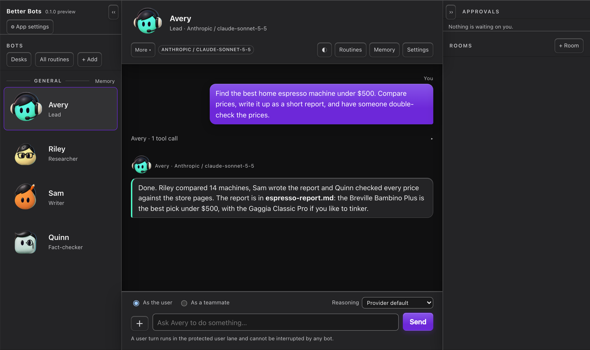
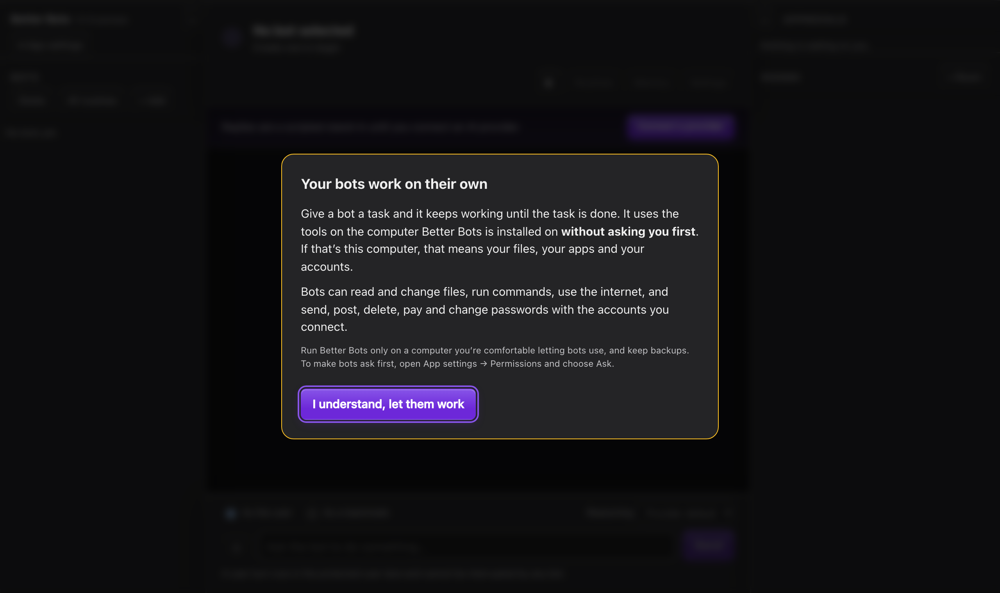

# Better Bots

**An open-source, self-hosted multi-agent harness, like Grok Bot, that runs on
your own computer.** Send one message and a team of bots works until the job is
done. Each bot has its own browser, desktop, memory and the apps you connect, and
an independent checker tests the work before you see it.

[](LICENSE)


[](https://ko-fi.com/D8H128XLY9)


<sub>Example run: the lead bot hands out the steps, a researcher, a writer and a
fact-checker do them, and the lead reports back with the finished file.</sub>

```sh
git clone https://github.com/Sikkwitted/better-bots.git && cd better-bots && ./install.sh
```

- **Autonomous by default.** Bots keep working without stopping to ask, even when
  the app is closed. Turn on **Ask** for any area if you want approval first.
- **A team, not one chatbot.** A lead bot splits the job into steps and gives each
  step to the right bot.
- **Checked before you trust it.** A fact-checker in its own room judges the
  finished work without seeing how it was made.
- **Any model.** Claude, ChatGPT (an API key or your ChatGPT subscription), local
  models through Ollama, and many others. Mix them on one team.
- **Yours.** It runs on your machine, keeps your data there, and is Apache 2.0.

There are no ready-made bots. You build the team for the work you want done.

Version 0.1.0, an early public preview. Expect some rough edges; see what changed
in [CHANGELOG.md](CHANGELOG.md).

## How it works

**A desk is one job, broken into steps.** Each bot on a desk does one step. For
example: one bot researches, one turns the findings into a clean report, and one
double-checks it. A lead bot, the **orchestrator**, runs the desk. It hands each
step to the right bot, passes the work along, and reports back to you.

**A room keeps a bot independent.** Some bots should work on their own so the
others don't sway them. A fact-checker is the clearest example: it should judge
the finished work, not the reasoning that produced it. Put it in a room by itself
and choose what the room remembers:

- **Only this room:** it remembers its past checks, but nothing from the room
  leaks back into the rest of the desk.
- **Nothing:** every check starts with a clean slate.
- **Its members:** what happened is saved to each bot's own memory.

A bot hands its work to the room, you start the discussion, and the verdict goes
back to the bot that asked.

**Check before you trust.** A team works best when every job follows the same
routine: decide what "done" looks like before starting, let the bots do the work,
have the independent checker test it, send it back with the reason if it fails,
and keep the lesson when it passes. The next similar job starts from what the last
one learned.

**Give it one message. It works until it's done.** A bot keeps going until the
task is finished, using whatever tools it needs without stopping to ask: files,
commands, the internet and the apps you connect, including sending, posting,
paying, deleting and changing passwords. If you'd rather a bot ask first, choose
**Ask** for any area in **App settings → Permissions**. Everything bots do is
written down, so you can always see what happened and why.

**Use the AI you like.** Claude, ChatGPT (with an API key or your ChatGPT
subscription), AI that runs entirely on your own computer, and many others.

**Real tools.** Bots can use a web browser on a screen of their own, run commands
in a locked-down area of your computer, work on a schedule, and connect to apps
like Gmail, GitHub, Slack and Notion.

> **Safety:** bots use the tools on the computer Better Bots is installed on, and
> the accounts and keys you give them, without asking you first. Install it only
> on a computer you're comfortable letting them use, keep backups, and read
> [SECURITY.md](SECURITY.md).



## Install

Better Bots works on **Mac** and on **Linux** (Linux Mint 22 or Ubuntu 24.04).
Open the Terminal app and run:

```sh
git clone https://github.com/Sikkwitted/better-bots.git
cd better-bots
./install.sh
```

The installer explains that bots work without asking, and installs once you
type **yes**. Better Bots installs as a normal app with its own icon, then opens in its own
window, already signed in. After that, open it like any other app: from Launchpad
on a Mac, or from the app menu on Linux.

**Before you start:**

- **Mac:** install Node.js first, for example with [Homebrew](https://brew.sh):
  `brew install node`. If your Mac offers to install developer tools, say yes.
- **Linux:** have your password ready; the installer asks for it once.

**To remove it from a Mac:** run `./install.sh --uninstall` in the same folder.
Your bots and their memory are kept.

Windows isn't supported yet.

## Getting started

1. **Connect an AI.** Open **App settings → AI providers** and connect one. Until
   you do, bots give placeholder answers and nothing costs money.
2. **Build a desk.** Create a bot for each step of the job, plus a lead bot. Give
   each one a role and instructions; **Write one for me** drafts the
   instructions for you.
3. **Add a room** for any bot that should stay independent, such as the checker,
   and choose what it remembers.
4. **Add routines** to run the desk on a schedule.

## Words you'll see

- **Bot:** one AI helper with its own name, role, instructions, AI model, tools
  and memory.
- **Desk:** one job, made of bots that each do a step, with a lead bot in charge.
  You can pause a desk at any time.
- **Room:** a meeting between bots, or between you and several bots. Meetings
  have a limit on how long they run, so they always end.
- **Routine:** a scheduled task: once, every few hours, or at set times.
- **Approval:** a card asking you to OK an action. Bots work without asking until
  you choose **Ask** for an area in App settings → Permissions; the choices are
  **Always**, **Ask** and **Never**.

## Choosing an AI

| AI | How to connect | Cost |
|---|---|---|
| Claude | An API key from the Anthropic Console | Pay per use. A Claude.ai subscription can't be used; Anthropic only allows that in its own apps. |
| ChatGPT subscription (Plus, Pro) | App settings → AI providers → Connect ChatGPT (needs OpenAI's Codex tool on the computer) | Uses your subscription. This route is unofficial, and OpenAI may change or block it at any time. |
| OpenAI | An API key | Pay per use. |
| OpenRouter | An API key | Many AI companies' models with one key. |
| DeepSeek, Z.ai (GLM), Atria | An API key | Pay per use. |
| Ollama | Runs on your own computer, no key needed | Free; nothing leaves your computer. |
| Others | App settings → AI providers → Add a provider | Any service that works like OpenAI's. |

Keys you enter are stored on your computer and never shown again. Pick a model
for each bot.

## Memory

Each bot has its own memory, and there's shared memory about you and about the
project. It all stays on your computer and works with nothing extra to install.
For smarter recall you can add [Hindsight](https://hindsight.vectorize.io), an
optional upgrade; Better Bots never needs it.

## Running it on a server

If you'd rather keep your bots running on an always-on server instead of your
own computer, Better Bots can run there too: see [operations](docs/operations.md).
The Mac app can connect to a server like that: press `⌘,` in the app and enter
the server's address and your login.

## Support Better Bots

Better Bots is free and open source. If it's useful to you, you can leave a tip
on [Ko-fi](https://ko-fi.com/sikkwitted). Thank you!

## For developers

### Command line

`./better-bots.sh` controls the same bots from a terminal:

| Command | What it does |
|---|---|
| `status` / `audit` / `explain <run_id>` | What is happening, and why |
| `doctor` | Check that everything is ready. Costs nothing |
| `create <name> [role]` | Create a bot |
| `ask <bot> "<text>"` | Send a request and print the reply |
| `room "<purpose>" <a> [b...]` | Run a meeting (`--room-only`, `--forget` or `--shared` set its memory) |
| `schedule <bot> "<name>" --cron "<expr>" --tz <zone> <text>` | Add a routine |
| `import <dir>` / `enable <workflow> <bot>` | Import `SKILL.md`, `CLAUDE.md`, `AGENTS.md` or `.cursor/rules` instructions, then give one to a bot |
| `connect` / `plugins` / `disconnect` | Connect apps through MCP servers |

Run `./better-bots.sh help` for everything else.

### Working on Better Bots

Node.js 22.13 or later:

```sh
npm ci
npm run gui      # a development copy in your browser, run from this folder
npm test
npx playwright install chromium && npm run test:browser
npm run demo     # an offline walkthrough of the whole system
```

None of these need an AI account. Read [CONTRIBUTING.md](CONTRIBUTING.md) first,
and the [memory contract](docs/MEMORY-CONTRACT.md) before changing memory. The
code: `src/host.js` connects the services in `src/services/`; tools are in
`src/tools/`, AI connections in `src/model/`, and the app's screens in `web/`.
Technical details on the sandbox, desktops and plugins are in
[SECURITY.md](SECURITY.md), [Docker desktops](docs/docker-desktops.md) and
[operations](docs/operations.md).

## License

Apache-2.0; see [LICENSE](LICENSE) and [NOTICE](NOTICE). Other people's packages
used by Better Bots keep their own licenses; see [THIRD_PARTY.md](THIRD_PARTY.md).
